# ILSlides

為 Android 手機打造的本機圖片瀏覽 App。藍黑漸層、圓角集合卡片與淡入淡出轉場。

## 安裝

前往 [GitHub Releases](https://github.com/Tidy1245/ILSlides/releases/latest) 下載 **ILSlides1-0-14.apk**，支援 **Android 9（API 28）以上**。與 Video-Box 相同，提供 Capacitor debug 簽章 APK 直接安裝。

## 使用方式

1. 先至設定頁「圖片資料夾」點「選擇／重新授權資料夾」，選擇圖片來源。App 會記住資料夾，下次直接點常用資料夾即可開啟。選取的資料夾會一併讀取所有子目錄中的圖片。設定頁每個資料夾右側可刪除捷徑，確認後從常用清單移除；既有集合、圖片及其讀取授權保留，也可重新加入。
2. 點底部右側「集合」，再點「新增集合」。第一頁挑選圖片，第二頁可手動輸入名稱或留空使用自動命名，兩頁可點步驟或左右滑動切換。
3. 在縮圖上勾選多張圖片；可跨資料夾繼續勾選。搜尋框可依檔名或子目錄名稱找圖，輸入目錄名稱會列出目錄內圖片並標示相對目錄路徑；右側漏斗提供檔名／修改日期的遞增與遞減排序，不提供日期的圖片排最後。全選僅加入目前搜尋結果，排序獨立保存。
4. 已選圖片長按約 450ms 後拖曳調整順序，拖到兩側可自動捲動；短按移除，一般滑動捲動清單。按返回／Escape 或系統取消會撤銷當次拖曳。點「下一步」到集合資訊頁設定名稱、標籤和封面，再點「建立集合」儲存；集合依已選圖片順序瀏覽。
5. 打開集合即以完整畫面顯示圖片；單指左右滑動切圖，兩指張開／捏合縮放（1～4 倍）、兩指同向移動平移查看區域。快速雙擊指定位置放大，再次雙擊恢復完整圖片；單擊約 280ms 後隱藏／顯示上方半透明標題列。下方說明及工具區已移除。返回首頁／集合頁時恢復原本捲動位置，搜尋及標籤條件保留。
6. 集合卡片右下角的三小點可選擇「編輯集合」或「刪除集合」；刪除需確認且只刪集合設定，原始圖片保留。編輯集合會直接開啟名稱／標籤／封面的集合資訊頁；可切回挑圖頁搜尋、排序來源圖片或拖曳已選圖片。新增集合仍從挑圖頁開始。
7. 點「選擇封面與調整視窗」，從集合選一張圖片，在 4:3 視窗拖曳位置及縮放 1～3 倍；點「使用此封面」再儲存集合。取消調整不變更封面。封面圖片移出集合後回退至集合第一張。
8. 點首頁「最近的集合」標題可切換「為你推薦」，從所有集合隨機挑選最多 4 筆；再點可切回最近修改的最多 4 筆。App 會記住上次模式。完整搜尋、新增、編輯、刪除與封面功能放在「集合」頁。
9. 搜尋框右側漏斗按鈕開啟「篩選與排序」：依字母、建立日期、修改日期遞增／遞減排序並保存，或複選標籤（符合任一所選標籤），與名稱搜尋共同套用。按套用才生效，關閉／返回取消草稿；可重設條件。
10. 集合頁按 Android 系統返回鍵：尚未在頁面頂部時先回到頂部；已在頂部時退出 App。新增與編輯集合的捲動區離開頂部時，右下方顯示半透明回頂部按鈕。
11. 頂部與底部導覽列固定；點頂部右側齒輪進入設定頁，版本號顯示在設定頁。滑桿調整圖片轉場 0.10～2.00 秒，預設 0.36 秒、自動保存。
12. 設定頁可調整雙擊放大倍率 1.50～4.00 倍、每格 0.25 倍，預設 2 倍，自動保存。切圖／淡入淡出保留倍率與相對查看位置，直橫圖依比例限位，螢幕旋轉後重新換算；重新開啟集合時恢復完整圖片。雙指操作必須全部放開後才接受下一次單指手勢。

自動命名新集合預設啟用，可在設定頁停用。名稱留空時，儲存採第一張目前仍選取的圖片檔名，套用 `^([^\s-]+)`：例如 `旅行-001.jpg`、`旅行 001.jpg` → `旅行`。若檔名主體只有數字，例如 `蘋果/0.jpg`，則以所在目錄「蘋果」命名。其他檔名無空白或 `-` 時保留完整檔名（包含副檔名）。手動名稱優先，不會自動改名已有集合；無法匹配或停用時，需自行輸入名稱。

設定頁可新增、修改與刪除標籤，自訂漸層起始／結束色，並直接修改序位調整順序（自動保存）；所有頁面的標籤都依此序位顯示，新增標籤排在最後，刪除後序位自動連續。新增或編輯集合可套用多個標籤，首頁及集合頁在名稱下方顯示。刪除標籤會解除集合上的參照，保留集合本身。

封面接近畫面時才載入，首頁優先載入最近 4 筆；已產生的縮圖保存於 App 私有快取目錄，再次開啟先顯示快取、背景檢查原圖變動。快取上限 64 MiB，淘汰最久未使用項目；來源缺少可靠修改資訊時每 24 小時重建。可於設定頁點「重新整理封面」清除縮圖快取，原圖與集合設定保留。

常用資料夾是找圖捷徑，集合是獨立的圖片清單。同一張圖片可加入不同集合。資料夾新增圖片不會自動加入既有集合；重新開啟集合會重載已選圖片。

## 升級與資料

- v1.0.0 舊集合在首次啟動時轉成固定圖片清單，保留原集合名稱與當時目錄內圖片；原目錄成為常用資料夾捷徑。轉換失敗時可編輯集合重新選圖。
- Android Storage Access Framework 保存目錄讀取授權，原始圖片不複製、不上傳、不修改；另保存可重建的封面縮圖。
- 新建集合會記錄建立／修改日期；編輯儲存只更新修改日期。日期保留供排序使用，卡片下方改顯示標籤；舊集合不捏造歷史日期。
- 集合名稱、選取的圖片 URI、日期、標籤、設定與資料夾捷徑保存於裝置 WebView localStorage；清除 App 資料／解除安裝後需要重建。
- 目錄挑圖預設依檔名自然排序，可改依修改日期排序，包含所有子目錄中的圖片；重複文件只列一次。集合按已選圖片順序瀏覽；左右循環。
- 預設 360ms、可調整 100～2000ms 的淡入淡出，先解碼再切換並預讀下一張；尊重減少動畫設定。
- 預覽長邊最多 2048 像素、封面最多 600、挑圖縮圖最多 320；原圖不變。
- 原生 ImageDecoder 處理 EXIF 方向；格式依裝置解碼器而定，GIF 以靜態預覽顯示。
- 目錄／檔案被移動、刪除或授權失效時，請重新授權資料夾並重新挑圖。
- Android 11 以上限制部分根目錄與 Android/data 等目錄，請選一般圖片子目錄。

## 開發、建置與發布

Vue 3 + TypeScript + Vite + Capacitor 8，自訂 Java ImageFolders 插件。

```powershell
npm ci
npm test
npm run build
npx cap sync android
$env:JAVA_HOME='<JDK 21 安裝目錄>'
cd android
.\gradlew.bat assembleDebug lintDebug
```

SDK 位置由 `android/local.properties` 設定（不提交）。完整 APK 建置與校驗檔可使用 `scripts/build-apk.ps1 -JavaHome '<JDK 21>'`。

**每次發布預設自動遞增 patch 一碼；使用者明確指定時採指定版號。** 發布前執行一次：

```powershell
npm run release:prepare          # 例如 1.0.5 → 1.0.6
npm run release:prepare -- 2.0.0 # 明確指定
```

此工具同步 package.json、package-lock.json、Android versionName，並遞增 Android versionCode。一般建置不改版號。更新 AGENTS.md 與發布說明後，建置 APK、提交推送 main，再建立 GitHub Release 上傳 `ILSlides<版號>.apk` 與 `SHA256SUMS.txt`。

UI 測試：安裝 Playwright 後執行 `npm run dev` 與 `node scripts/ui-smoke.mjs`、`node scripts/cache-tags-smoke.mjs`、`node scripts/zoom-smoke.mjs`、`node scripts/picker-reorder-smoke.mjs`、`node scripts/folder-settings-smoke.mjs`、`node scripts/folder-name-search-smoke.mjs`、`node scripts/home-menu-smoke.mjs`、`node scripts/editor-pages-smoke.mjs`、`node scripts/tag-order-smoke.mjs`；可用 `PLAYWRIGHT_MODULE` 指定模組路徑，`APP_URL` 指定測試網址。原生 bridge 使用模擬資料。

## 未發布更新

- 編輯集合預設開啟集合資訊頁；新增集合仍預設挑圖頁。
- 設定頁可手動修改集合標籤序位，統一套用至首頁、集合、挑選標籤及篩選視窗，重開後保留。
- 72 項單元測試與正式建置通過；新增序位輸入、跨頁一致性、保存及編輯初始頁的手機 UI 回歸。
- 本次僅更新程式碼，版本維持 1.0.14，未發布 APK。

## v1.0.14 驗證

- 新增／編輯集合分成挑圖與集合資訊兩頁，可點步驟或左右滑動切換；切頁時有水平轉場，第一頁底部為「下一步」。
- 驗證結果與實機限制見 [v1.0.14 發布說明](docs/release-v1.0.14.md)。

## v1.0.13 驗證

- 首頁可切換最近集合與隨機推薦，重開後保留模式；集合卡片選單提供編輯與確認刪除，編輯頁不再顯示刪除按鈕。
- 驗證結果與實機限制見 [v1.0.13 發布說明](docs/release-v1.0.13.md)。

## v1.0.12 驗證

- 新增／編輯集合時，搜尋圖片檔名或子目錄名稱都可找到圖片；目錄搜尋命中的圖片會顯示相對目錄路徑。
- 第一張圖片檔名只有數字時，自動命名採用所在目錄名稱，例如 `蘋果/0.jpg` 命名為「蘋果」。
- 驗證結果與實機限制見 [v1.0.12 發布說明](docs/release-v1.0.12.md)。

## v1.0.11 驗證

- 已發布 versionName 1.0.11／versionCode 12；APK 簽章與 v1.0.10 相同，可覆蓋升級。
- 設定頁新增資料夾捷徑刪除及取消／返回確認，移除後重新開啟仍維持刪除；既有集合圖片可繼續瀏覽。
- 挑圖包含來源資料夾所有子目錄的圖片，保留檔名與修改日期供搜尋／排序；防止重複文件與循環目錄。
- 64 項 TypeScript 單元測試、12 項 Android 單元測試（含 6 項遞迴掃描測試）、正式建置、APK 建置與 lint 通過。
- 新增手機資料夾刪除回歸：取消、Escape／Android 返回、重開保存、舊資料不復活、既有集合讀圖與重新加入。
- UI 原生 bridge 使用模擬資料，未接 Android 實機。

## v1.0.10 驗證

- 移除圖片瀏覽的「讀取中」提示，以及集合／資料夾挑圖搜尋框內建的重複清除叉號。
- 62 項 TypeScript 單元測試、正式建置與 Chromium 驗證通過；延遲圖片讀取及前後切圖期間不顯示讀取提示，兩個搜尋框保留單一清除按鈕並可正常清空。
- 5 項 Android 快取測試、APK 建置與 lint、版本／簽章／SHA-256 校驗通過。原生 bridge 使用模擬資料，未接 Android 實機。

## v1.0.9 驗證

- 62 項 TypeScript 單元測試、型別檢查與正式建置、5 項 Android 封面快取測試、Android 建置與 lint、APK 版本／簽章／SHA-256 檢查。
- 新增挑圖 UI 測試涵蓋設定頁授權／取消／重新授權、跨資料夾選取、搜尋／全選結果、四種圖片排序／取消／重設／保存，以及集合排序與已選順序獨立。
- Chromium 真實觸控事件驗證長按前後拖曳、短按移除、一般滑動捲動、邊緣自動捲動、系統取消／Escape／Android 返回撤銷、建立與編輯後順序保存及瀏覽順序。
- 既有集合、封面、標籤、快取、篩選、返回位置與雙指／雙擊縮放三組 UI 回歸通過。原生 bridge 使用模擬資料，未接 Android 實機。

| 資料夾圖片搜尋 | 圖片排序 | 長按拖曳 |
| --- | --- | --- |
| 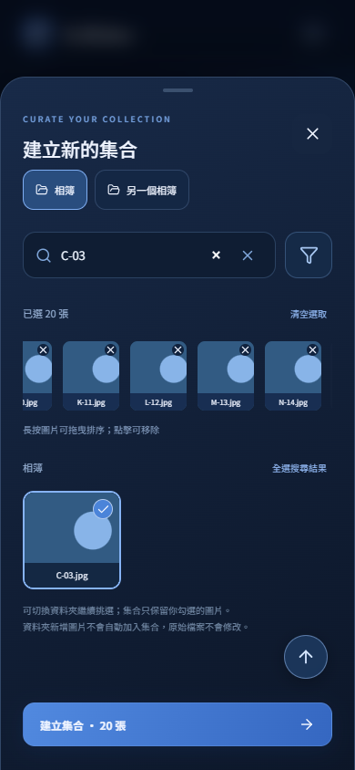 |  | 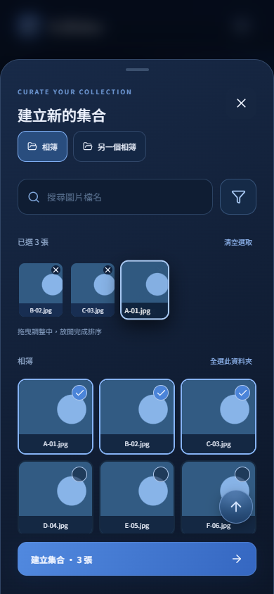 |

## v1.0.8 驗證

- 型別檢查、正式建置、55 項 TypeScript 單元測試及 5 項 Android 封面快取測試。
- 縮放 UI 測試透過 Chromium 真實觸控事件驗證指定區域雙擊、倍率保存、雙指縮放／平移、部分抬指／取消不切圖、放大時單指切圖、轉場中倍率同步、跨長寬比／旋轉保持及重新進入集合重設。
- UI 測試涵蓋 200 個集合的可見優先／快取、漸層標籤與篩選視窗的全部排序選項、標籤複選／搜尋組合／取消／重設，以及首頁／集合頁在圖片瀏覽返回後恢復捲動位置。
- 手機 UI 測試新增編輯集合回頂部、空名稱自動命名、選取順序變更、手動名稱優先、停用開關／重開保存與已有集合不自動改名；既有返回鍵、瀏覽、設定、排序、封面、搜尋與升級流程回歸通過。
- Android APK 建置與 lint 通過；APK 簽章與 SHA-256 驗證。
- 此次未連接 Android 實機，目錄持久授權與裝置圖片解碼仍需實機確認。

## 畫面

使用測試圖片，非 App 預載照片。

| 選擇圖片（第一頁） | 集合資訊（第二頁） |
| --- | --- |
|  |  |

封面裁切操作：

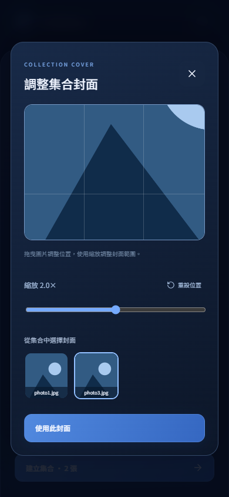

首頁與設定頁：

| 首頁 | 設定 |
| --- | --- |
| 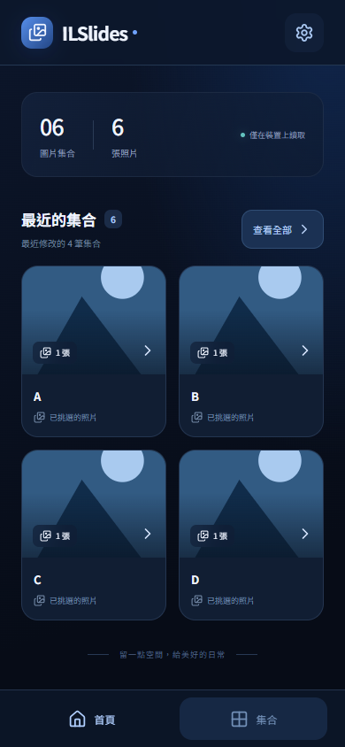 | 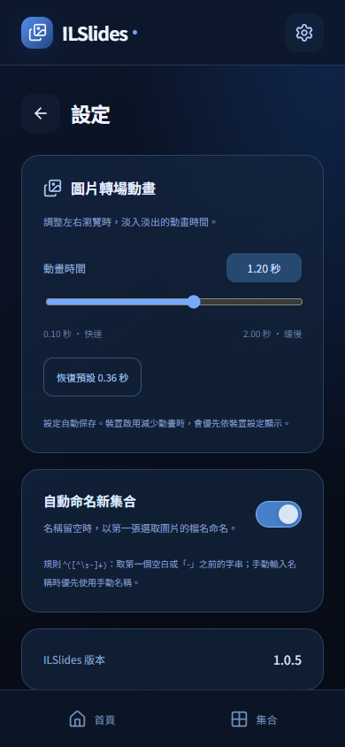 |

圖片瀏覽與新增集合回頂部按鈕：

| 全畫面瀏覽 | 新增集合捲動 |
| --- | --- |
|  | 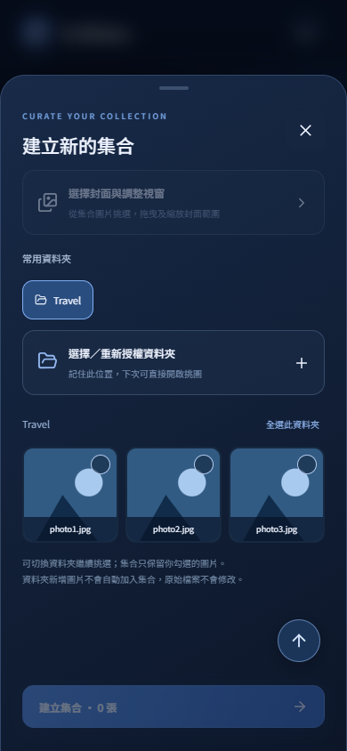 |

自動命名與編輯集合回頂部：

| 新集合名稱留空 | 編輯集合回頂部 |
| --- | --- |
| 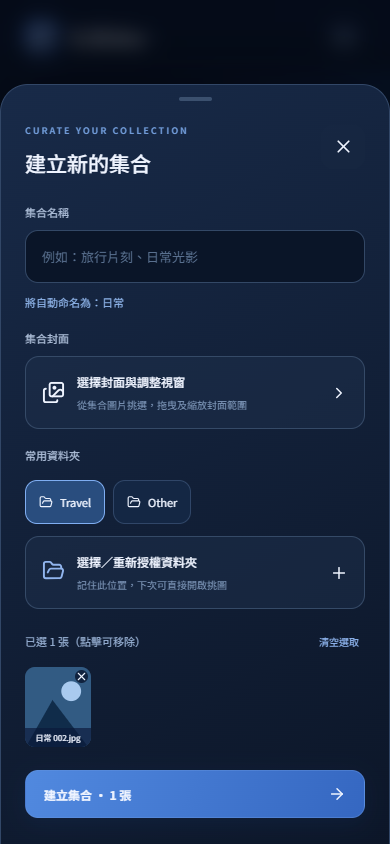 | 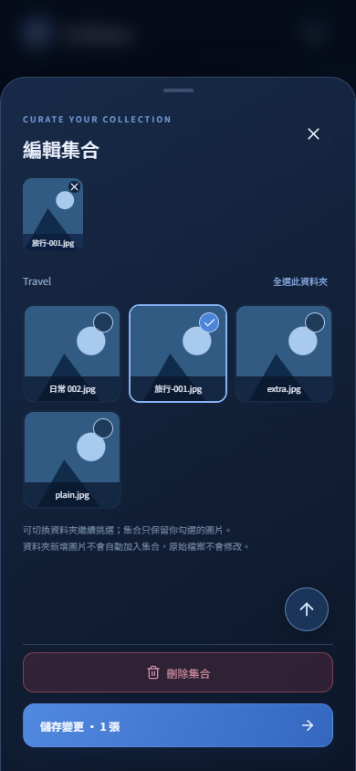 |

漸層標籤與設定：

| 集合標籤 | 設定管理 |
| --- | --- |
| 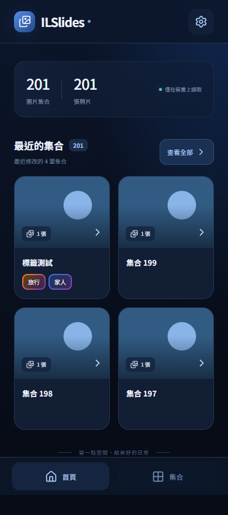 | 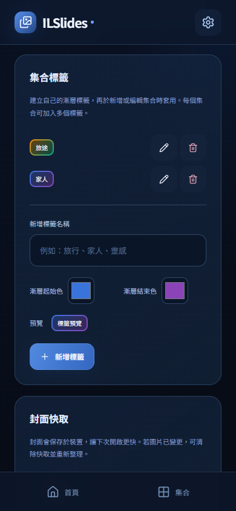 |

篩選與排序：

| 搜尋框與漏斗 | 篩選視窗 |
| --- | --- |
| 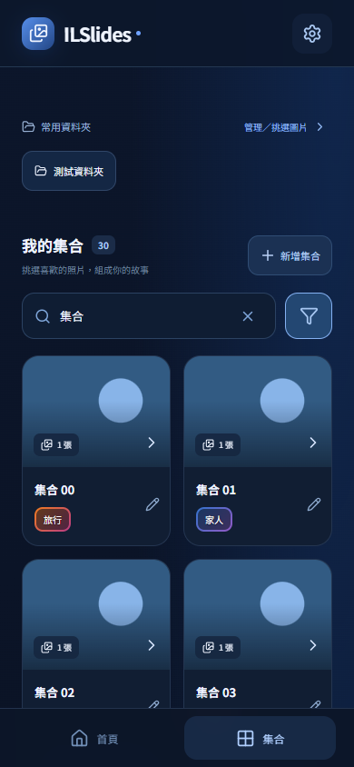 | 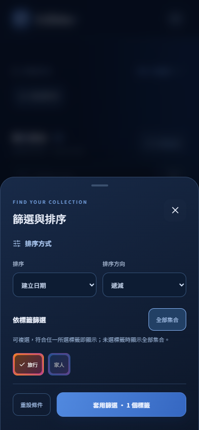 |

圖片縮放與倍率設定：

| 放大查看指定區域 | 雙擊倍率設定 |
| --- | --- |
| 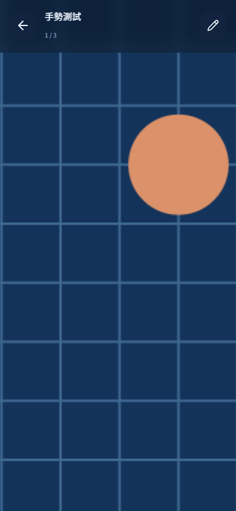 | 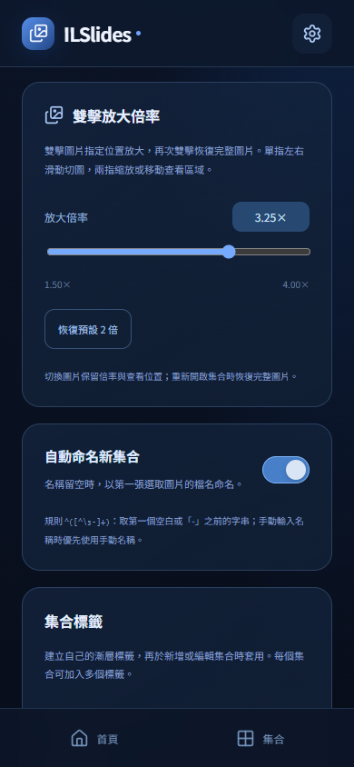 |
