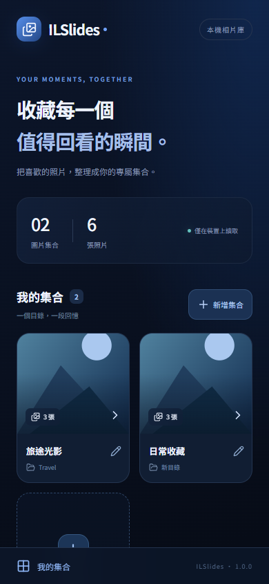
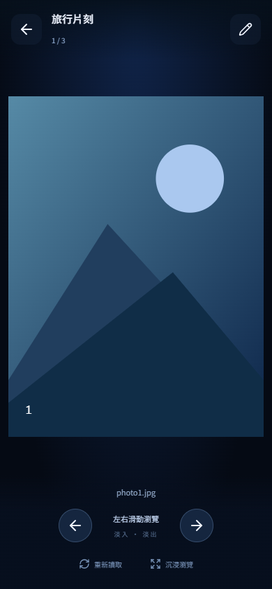

# ILSlides

為 Android 手機打造的本機圖片瀏覽 App。藍黑漸層、圓角集合卡片與淡入淡出轉場。

## 安裝

前往 [GitHub Releases](https://github.com/Tidy1245/ILSlides/releases/latest) 下載 **ILSlides1-0-0.apk**。支援 **Android 9（API 28）以上**。與 Video-Box 相同，使用 Capacitor 與 debug 簽章 APK，適合直接安裝；不屬於 Google Play 商店版本。

## 使用方式

1. 點「新增集合」，輸入集合名稱。
2. 點「選擇裝置目錄」，在 Android 系統檔案選擇器中選擇目錄並授權。
3. 建立後點集合卡片，左右滑動或點箭頭瀏覽照片。
4. 點畫面或「沉浸瀏覽」隱藏操作列；再點畫面恢復。
5. 可編輯名稱、重新選目錄或移除集合。移除集合不刪除原始圖片。
6. 目錄有新圖片時點「重新讀取」。重開 App 也會重新讀取集合封面與張數。

## 圖片與資料

- 每個集合連結一個目錄，可建立多個集合；目前讀取目錄內的圖片，不遞迴讀取子目錄。
- 依檔名自然排序，例如 photo2 排在 photo10 前。最後一張再往右回到第一張。
- 透過 Android Storage Access Framework 保存目錄讀取授權，圖片不複製進 App、不上傳。
- 集合名稱與目錄 URI 保存在裝置 WebView localStorage；解除安裝／清除資料後需要重建。
- 圖片預覽長邊最多 2048 像素，封面最多 600 像素，原圖不會修改。
- 原生 ImageDecoder 處理 EXIF 方向；支援 JPG、PNG、WebP、GIF、HEIC 等裝置可解碼格式，GIF 以靜態預覽顯示。
- 跨淡入淡出轉場為 360ms，切換前解碼圖片並預讀下一張；尊重系統減少動畫設定。
- 若原始目錄／圖片被移動、刪除或授權失效，需重新選擇目錄。
- Android 11 以上系統限制部分根目錄、Download 根目錄與 Android/data 等目錄的選取，請選一般圖片子目錄。

## 開發與建置

Vue 3 + TypeScript + Vite + Capacitor 8，自訂 Java ImageFolders 插件。

```powershell
npm ci
npm test
npm run build
npx cap sync android
$env:JAVA_HOME='<JDK 21 安裝目錄>'
cd android
.\gradlew.bat assembleDebug
```

Android SDK 位置由 `android/local.properties` 設定（不提交）。APK 原始位置：`android/app/build/outputs/apk/debug/app-debug.apk`。

UI 自動測試：安裝 Playwright 後，先執行 `npm run dev`，再執行 `node scripts/ui-smoke.mjs`。可使用 `PLAYWRIGHT_MODULE` 指定 Playwright 模組路徑。測試使用模擬 native bridge，涵蓋手機版面、建立／重新命名／保存／移除集合及圖片前後循環；不代表 Android 目錄授權已經實機測試。

## v1.0.0 驗證

- 前端型別檢查、正式建置與 3 項單元測試通過。
- 390 × 844 手機瀏覽器 UI 自動測試通過。
- Android APK 完整建置與 APK 簽章／metadata 驗證。
- 此次沒有連接 Android 裝置，目錄選取、重開持久授權與裝置解碼仍需實機確認。

## 畫面

以下 viewer 使用測試圖片，非預載照片。

| 集合首頁 | 圖片瀏覽 |
| --- | --- |
|  |  |

